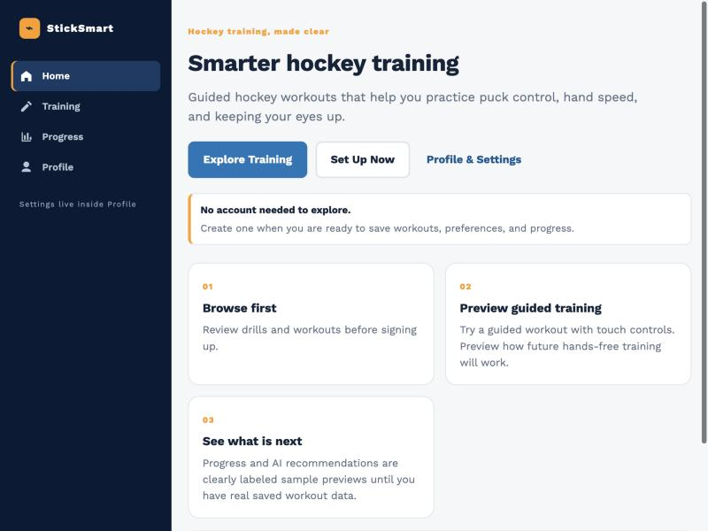
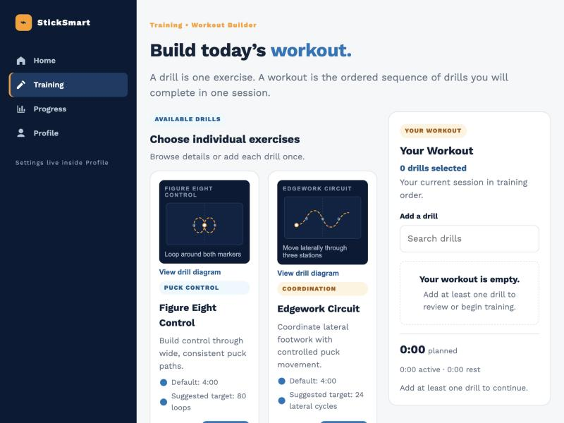
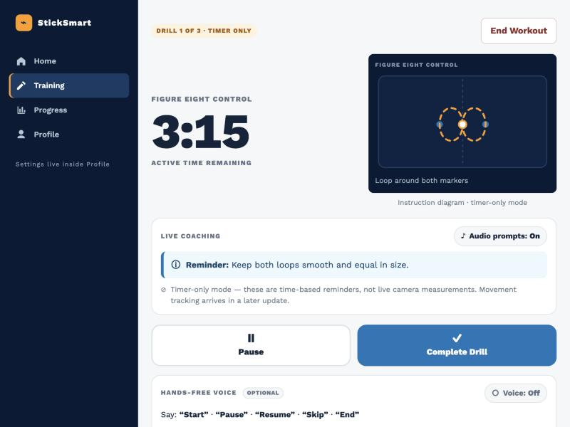
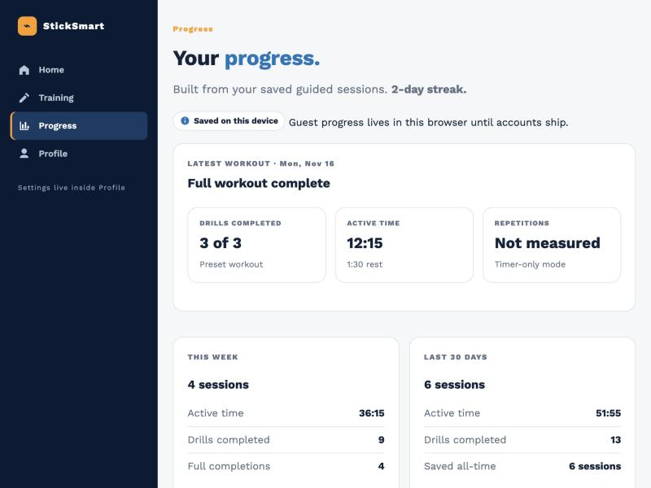
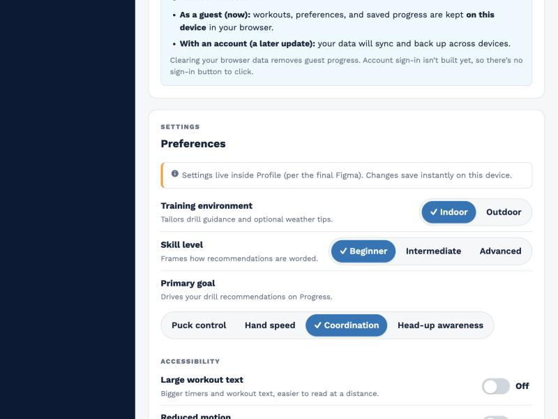

# StickSmart — Demo Script (TRI-30)

**Owner:** Nela · **Cycle 5** · Target length: ~4–5 minutes.

A full, end-to-end walkthrough that follows the **working release**. Each step
lists what to **do**, what to **say**, and the screen it lands on. Screenshots
here are from the current build; recapture them if the UI changes before the
demo.

> **Setup before demoing:** run `python3 -m http.server 8000 --directory frontend`
> and open <http://localhost:8000>. For a lively Progress screen, complete one or
> two guided sessions first (demo speed is on by default, so this is quick). Keep
> **demo speed on** during the walkthrough.

---

## 0. Framing (15s)

> "StickSmart is a web-based hockey training assistant. Today it runs in
> **timer-only mode** — it guides and times your stickhandling workout and saves
> your progress. Camera-based rep and technique tracking is the next phase, and
> you'll see the app is honest about that throughout."

## 1. Home & honesty (20s)

- **Do:** Start on **Home**.
- **Say:** "No account needed — you start as a guest and can browse, train, and
  save on your device. Notice the note: timers and navigation work; camera
  tracking, voice, and AI advice that aren't built are clearly labelled, not
  faked."

## 2. Build a workout (45s)

- **Do:** Click **Explore Training**. Show the three paths: **Manual**, **Preset
  (Quick Hands Builder)**, **Recommended**. Open one drill's **details**
  (instructions, marker placement, what counts as a rep, technique cue, animated
  diagram). Add two or three drills with **+ Add drill**.
- **Say:** "A *drill* is one exercise; a *workout* is the ordered sequence. Each
  drill explains exactly how to do it and what counts as a rep. I'll build a
  quick custom workout."

## 3. Review & reorder (25s)

- **Do:** Click **Review Workout**. Drag a row or use ↑/↓ to reorder; remove one
  and hit **Undo**. Point out the live active/rest/planned totals.
- **Say:** "This is the exact order the session runs. I can reorder by drag or
  buttons, and undo a removal in one step. Totals update live."

## 4. Guided session (90s) — the core

- **Do:** Click **Choose Training Mode**. On **Ready**, point out demo speed,
  the audio-prompt toggle, and the optional voice panel. Start the **3-second
  countdown**. On **Active**, show:
  - the large timer and **Complete Drill** / **Pause** controls,
  - the **Live coaching** reminder (icon + words),
  - the honesty line ("timer-only — not live camera measurements"),
  - the **hands-free voice** panel (say it's optional; "End" always confirms).
  Pause once to show timers freeze, resume, then **Complete Drill** to move into
  **Rest**, then into the next drill. Finish the workout.
- **Say:** "Controls are big and glove-friendly. Timers are pause-aware — paused
  time doesn't count. Coaching cues are time-based reminders, and the app says
  so. Voice is optional and only handles start/pause/resume/skip/end; a
  misheard 'end' just opens a confirmation."

## 5. Summary (15s)

- **Do:** On the **Summary**, show drills completed (full vs. early, partial
  marked), elapsed active/rest time, and the timer-only label.
- **Say:** "Every finished session — complete or ended early — is saved to
  Progress."

## 6. Progress & recommendations (45s)

- **Do:** Open **Progress**. Show the latest-workout summary, this week / last 30
  days, the streak, the focus-balance bars, and a recommendation.
- **Say:** "This is built from **real saved metrics**, not demo data. Reps show
  **'Not measured'** — honest, because timer-only mode can't count them, and
  that's different from zero. Recommendations are simple, explainable rules that
  **cite the activity they're based on** — here, it noticed I've done little
  awareness work and suggests the Head-Up Challenge."

## 7. Settings & accessibility (30s)

- **Do:** Open **Profile → Settings**. Toggle **Large workout text** (watch text
  scale), toggle **Reduced motion**, change **Primary goal**. Point out the
  optional location opt-in is off by default.
- **Say:** "Every setting works and saves instantly on the device. Accessibility
  toggles apply app-wide. The optional location prompt is off by default, and
  declining it never blocks indoor training."

## 8. Close (15s)

> "So: a guided, honest, accessible hockey trainer that works today in the
> browser with no account — and a clear path to camera-based tracking next."

---

## Demo logistics & fallback

- **Primary:** live demo on a laptop at 1280×800 or a phone (test on a real
  device first — mobile preview ≠ real device).
- **Fallback recording:** record a screen capture of this exact script as a
  backup in case live fails. _(Owner to attach the recording link here before the
  handoff.)_
- **Reset between runs:** to show the empty Progress state, clear the browser's
  site data (or use a private window).

## Handoff checklist

- [x] Demo follows the working release end to end.
- [x] Screenshots match the current build (recapture if UI changes).
- [ ] Fallback screen recording captured and linked above. _(human step)_
- [ ] User guide + demo script reviewed by a teammate. _(human step)_
