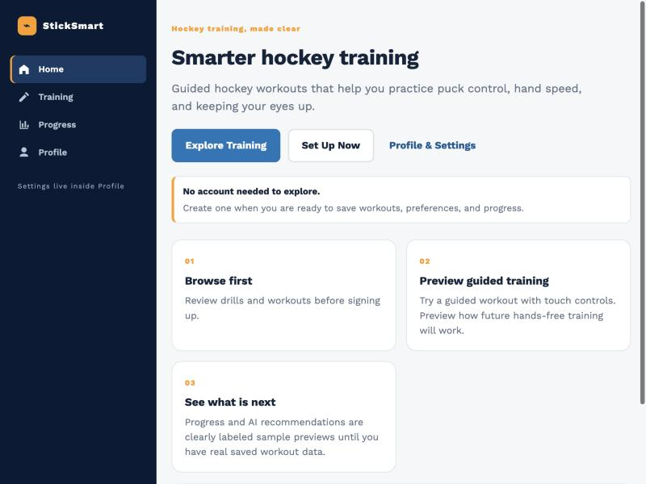
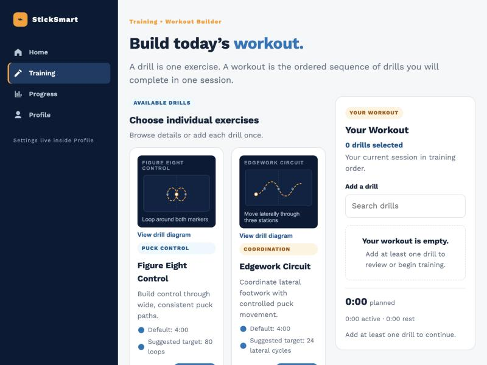
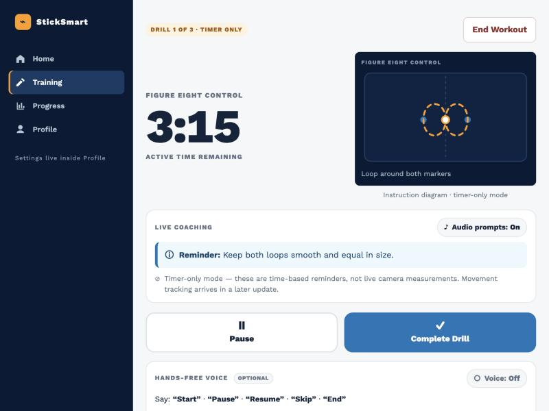
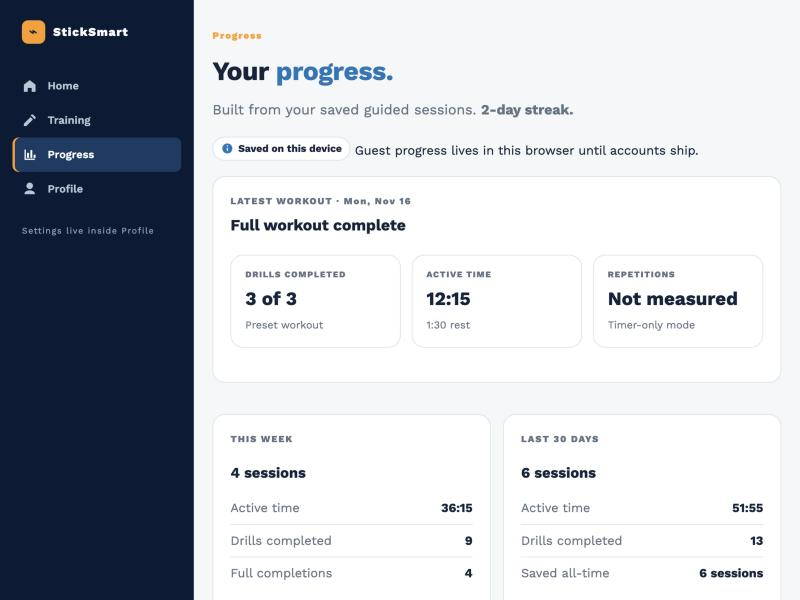
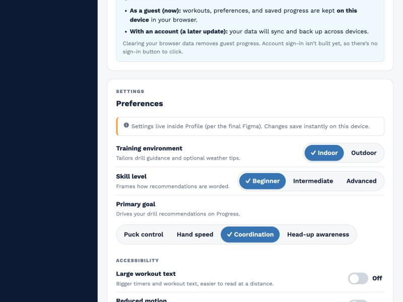

# StickSmart — User Guide

StickSmart is a web-based hockey training assistant. It gives you guided,
timer-based stickhandling workouts with large, glove-friendly controls, live
heads-up reminders, and saved progress — no account required.

> **Scope / honesty:** this release runs in **timer-only mode**. It guides and
> times your workout and records elapsed time and drill completion. It does
> **not** use a camera, so it does not measure repetitions or technique. Those
> arrive with camera tracking in a later update, and the app says so wherever it
> matters.

## 1. Getting started

No install, no account. Open the app in a browser:

```bash
python3 -m http.server 8000 --directory frontend
```

Then open <http://localhost:8000>. You start as a **Guest** — browse, build, and
train right away. Everything you save (workouts, preferences, progress) is kept
**in that browser, on that device**.



**Navigation** is always visible: **Home · Training · Progress · Profile**
(Settings live inside Profile). On a phone these move to a bottom dock, with a
menu button that opens the sidebar as a drawer.

## 2. Key terms

| Term | What it means in StickSmart |
|---|---|
| **Drill** | One exercise (e.g. *Figure Eight Control*), with its own goal, work interval, and technique cue. |
| **Repetition** | What counts as one rep for that drill (shown on the drill's detail page). *Not auto-counted in timer-only mode.* |
| **Workout** | An ordered **sequence of drills** you complete in one session. |
| **Rest** | The timed break **between drills** (no rest after the last drill). |
| **Quality / technique feedback** | The **Live coaching** reminders during a drill (heads-up, posture, "ten seconds left"). In timer-only mode these are time-based reminders, not camera measurements. |

## 3. Build a workout

Open **Training**. There are three ways to assemble a session:

- **Manual** — browse the drill library and **+ Add drill** (or use *Add a drill*
  search) to build a custom workout.
- **Preset** — *Quick Hands Builder*, a ready-made 3-drill sequence, kept
  separate from your custom workout.
- **Recommended** — the same sequence surfaced as a clearly-labelled sample.



Open any drill for **details**: how to perform it, marker placement, equipment,
environment, what counts as one rep, work/rest intervals, and a technique cue
(with an animated movement diagram).

**Review** lists your drills in training order. Reorder by drag or the ↑/↓
controls; remove with one-step **Undo**. Totals (active / rest / planned) update
live. Your custom workout **persists**, so it survives navigation and reloads.

## 4. Train a guided session

From **Review**, choose **Choose Training Mode** to start the guided session. Each
drill runs a phase cycle:

**Ready → Countdown (3s) → Active → Rest → … → Summary**



- **Big, glove-friendly controls:** Pause/Resume, Complete Drill, Skip Rest, and
  End Workout (which confirms first).
- **Pause-aware timers:** paused time and time spent in the end-workout dialog are
  excluded from your elapsed totals.
- **Live coaching:** heads-up / posture reminders and a "ten seconds left"
  prompt. Every cue uses an **icon + words** (never colour alone). **Audio
  prompts** can be muted, and pausing silences them.
- **Hands-free voice (optional):** say *Start · Pause · Resume · Skip · End*. It's
  off by default, exposes only those commands, and "End" opens a confirmation so
  a mishear can't end your session. Browsers without speech recognition simply
  don't show it — touch always works.
- **Demo speed** (on by default) runs timers ~15× so you can review the flow
  quickly; turn it off on the Ready screen for real-time training.

At the end, the **Summary** shows drills completed (full vs. ended-early, with any
partial drill marked), elapsed active and rest time, and that it was timer-only.

## 5. See your progress

Open **Progress**. After your first guided session, this is built from **your
real saved metrics** (on this device):



- **Latest workout** summary, **this week** and **last 30 days** feedback, and a
  training **streak**.
- **Focus balance** — completed drills per focus.
- **Recommendations** — simple, explainable suggestions that **cite the activity
  they're based on** and link to the drill.
- **Repetitions show "Not measured"** (not `0`) because timer-only mode can't
  count them yet.

Before your first session, Progress shows a helpful empty state with a clearly
labelled example.

## 6. Preferences & accessibility

Open **Profile → Settings**. Every control works and saves instantly on your
device:



- **Training environment**, **skill level**, **primary goal** (drives your
  recommendations).
- **Large workout text** and **Reduced motion** (accessibility).
- **Audio prompts** on/off (shared with the session).
- **Optional location** for outdoor weather tips — **off by default**, and
  declining it never blocks indoor training.

The optional **Setup** flow (Home → *Set Up Now*) walks the same choices in a
short, skippable 1-2-3; you can skip it and train immediately.

## 7. Limits to know

- **Timer-only:** no camera, no rep/technique measurement yet.
- **Guest / on-device:** data lives in this browser. Clearing browser data
  removes it. Accounts and cross-device sync are a later update, so there is no
  sign-in button yet.
- **Mobile preview ≠ real device:** test on an actual phone before relying on it.
